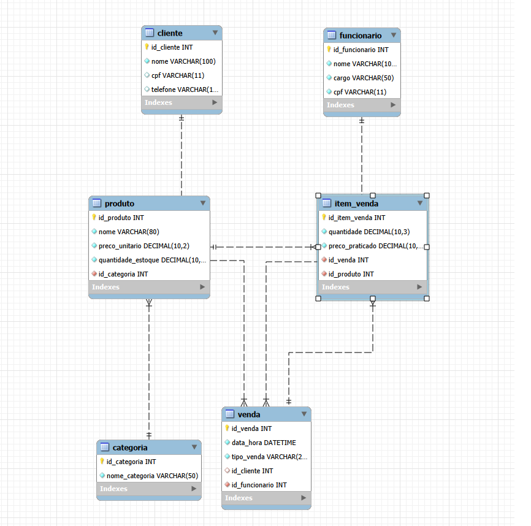

# Atividade III - SEDUC DEST2: Banco de Dados Panificadora Pão D'Ouro

---

## 1. Domínio do Banco de Dados
**Domínio:** Gestão Integrada de Vendas, Estoque e Produção de Panificadora (*Panificadora Pão D'Ouro*).

**Descrição do Domínio:** O banco de dados abrange o controle das operações diárias de uma padaria de médio porte, contemplando o cadastro centralizado de categorias e produtos, controle de estoque de insumos e mercadorias, registro de clientes e funcionários, gestão de vendas de balcão e acompanhamento de encomendas para eventos.

---

## 2. Contextualização

### A Empresa
A **Panificadora Pão D'Ouro** é um estabelecimento comercial de médio porte que atua no ramo de panificação, confeitaria e lanchonete. A empresa realiza vendas rápidas no balcão (pão francês, fatiamento de frios, cafés) e atendimento sob encomenda para eventos (bolos decorados e salgados).

### Problemas Enfrentados sem um SGBD Relacional
Atualmente, a padaria opera sem um banco de dados centralizado, utilizando anotações em cadernos, comandas em papel e planilhas avulsas, o que gera os seguintes problemas:

1. **Descontrole de Estoque e Desperdício de Insumos:** Dificuldade para rastrear a quantidade exata de matérias-primas e produtos, resultando em perdas por validade ou interrupção da produção.
2. **Perda e Atraso nas Encomendas:** Pedidos de bolos e salgados anotados em papel levam ao esquecimento de prazos e troca de especificações de pedidos.
3. **Inconsistência e Erros de Preços no Caixa:** Ausência de catálogo unificado, fazendo com que atendentes apliquem valores incorretos no balcão.
4. **Retrabalho e Redundância de Dados:** Redigitação manual dos dados de clientes a cada novo pedido sob encomenda.
5. **Ausência de Histórico Financeiro:** Impossibilidade de consultar o faturamento real, ticket médio ou desempenho de vendas por funcionário.

---

## 3. A Proposta de Melhoria - Solução com um SGBD Relacional

### Solução Proposta
Para resolver todos os problemas identificados na **Panificadora Pão D'Ouro**, propõe-se a implementação de um Banco de Dados Relacional utilizando o **MySQL**. A solução centraliza o catálogo de produtos, automatiza o controlo de stock e regista todas as movimentações de vendas e encomendas com integridade referencial.

### Benefícios Diretos da Solução
1. **Centralização e Padronização do Catálogo (Fim dos Erros de Preço):**
   * Registo unificado de produtos e categorias com preços atualizados, garantindo que o caixa consulte e aplique sempre o valor correto.
2. **Controlo Automatizado de Stock:**
   * Atualização em tempo real das quantidades de produtos e insumos, permitindo emitir alertas de reposição antes da rutura na produção.
3. **Gestão Eficiente de Encomendas e Vendas:**
   * Registo estruturado de cada venda associado ao funcionário responsável e, no caso das encomendas, ao cliente respetivo, eliminando perdas em papéis.
4. **Integridade Referencial e Eliminação de Redundâncias:**
   * Utilização de Chaves Estrangeiras (FK) para reaproveitar os dados dos clientes e funcionários sem necessidade de reescrever informações em cada novo pedido.
5. **Histórico Financeiro e Relatórios Gerenciais:**
   * Possibilidade de realizar consultas rápidas e extrair relatórios sobre o faturamento total, ticket médio e produtos mais vendidos no estabelecimento.

  ---

## 4. Apresentar esta proposta de melhoria com a modelagem lógica do Banco de Dados

### Diagrama da Modelagem Lógica

### Tabelas, Campos e Tipos
1. **`categoria`**:
   * `id_categoria`: `INT` (Chave Primária - PK, Auto Incremento, NOT NULL)
   * `nome_categoria`: `VARCHAR(50)` (NOT NULL)

2. **`produto`**:
   * `id_produto`: `INT` (Chave Primária - PK, Auto Incremento, NOT NULL)
   * `nome`: `VARCHAR(80)` (NOT NULL)
   * `preco_unitario`: `DECIMAL(10,2)` (NOT NULL)
   * `quantidade_estoque`: `DECIMAL(10,3)` (NOT NULL, DEFAULT 0.000)
   * `id_categoria`: `INT` (Chave Estrangeira - FK, NOT NULL)

3. **`cliente`**:
   * `id_cliente`: `INT` (Chave Primária - PK, Auto Incremento, NOT NULL)
   * `nome`: `VARCHAR(100)` (NOT NULL)
   * `cpf`: `VARCHAR(11)` (UNIQUE)
   * `telefone`: `VARCHAR(15)`

4. **`funcionario`**:
   * `id_funcionario`: `INT` (Chave Primária - PK, Auto Incremento, NOT NULL)
   * `nome`: `VARCHAR(100)` (NOT NULL)
   * `cargo`: `VARCHAR(50)` (NOT NULL)
   * `cpf`: `VARCHAR(11)` (UNIQUE, NOT NULL)

5. **`venda`**:
   * `id_venda`: `INT` (Chave Primária - PK, Auto Incremento, NOT NULL)
   * `data_hora`: `DATETIME` (NOT NULL)
   * `tipo_venda`: `VARCHAR(20)` (NOT NULL)
   * `id_cliente`: `INT` (Chave Estrangeira - FK, NULL / Opcional)
   * `id_funcionario`: `INT` (Chave Estrangeira - FK, NOT NULL)

6. **`item_venda`**:
   * `id_item_venda`: `INT` (Chave Primária - PK, Auto Incremento, NOT NULL)
   * `quantidade`: `DECIMAL(10,3)` (NOT NULL)
   * `preco_praticado`: `DECIMAL(10,2)` (NOT NULL)
   * `id_venda`: `INT` (Chave Estrangeira - FK, NOT NULL)
   * `id_produto`: `INT` (Chave Estrangeira - FK, NOT NULL)

### Relacionamentos e Cardinalidades
* **`categoria` $\rightarrow$ `produto` (1:N — 1 para Muitos):**
  Uma categoria agrupa um ou vários produtos; cada produto pertence a apenas uma categoria.
* **`cliente` $\rightarrow$ `venda` (1:N — 1 para Muitos):**
  Um cliente pode realizar várias vendas/encomendas; cada venda é associada a no máximo um cliente (opcional no balcão).
* **`funcionario` $\rightarrow$ `venda` (1:N — 1 para Muitos):**
  Um funcionário registra várias vendas; cada venda tem um único funcionário responsável.
* **`venda` $\rightarrow$ `item_venda` (1:N — 1 para Muitos):**
  Uma venda contém um ou vários itens; cada item pertence a uma única venda específica.
* **`produto` $\rightarrow$ `item_venda` (1:N — 1 para Muitos):**
  Um produto pode estar presente em vários itens de venda; cada item refere-se a um único produto.
* **`venda` $\leftrightarrow$ `produto` (N:M — Muitos para Muitos):**
  Relacionamento de Muitos para Muitos resolvido na prática através da tabela associativa **`item_venda`**.

  ---

## 5. Aplicar as Formas Normais: 1FN, 2FN, 3FN e 4FN

A aplicação das Formas Normais garante um banco de dados otimizado, sem redundâncias e livre de anomalias de inserção, atualização ou exclusão.

### 1ª Forma Normal (1FN) - Atributos Atômicos e Eliminação de Grupos Repetidos
* **Regra:** Todos os campos devem conter apenas valores atômicos (indivisíveis) e não devem existir colunas ou grupos de dados repetidos.
* **Aplicação na Proposta:** 
  * Os dados dos clientes e funcionários foram separados em campos individuais (`nome`, `cpf`, `telefone`).
  * Não existem campos compostos ou multivalorados na mesma coluna (por exemplo, guardar múltiplos telefones separados por vírgula no mesmo campo).
  * Os itens comprados numa venda foram removidos da tabela `venda` e isolados na tabela `item_venda`, evitando colunas repetidas do tipo `produto1`, `produto2`, `produto3`.

### 2ª Forma Normal (2FN) - Dependência Funcional Total
* **Regra:** O banco deve estar na 1FN e todos os atributos não-chave devem depender totalmente da Chave Primária (PK) completa da tabela, eliminando dependências parciais.
* **Aplicação na Proposta:**
  * Todas as tabelas possuem uma Chave Primária simples (atributo único autoincrementado: `id_categoria`, `id_produto`, `id_cliente`, `id_funcionario`, `id_venda`, `id_item_venda`).
  * Como não utilizamos chaves primárias compostas, todos os atributos não-chave de cada tabela dependem a 100% da sua respetiva chave primária, garantindo a 2FN.

### 3ª Forma Normal (3FN) - Eliminação de Dependências Transitivas
* **Regra:** O banco deve estar na 2FN e nenhum atributo não-chave pode depender de outro atributo não-chave (eliminação de dependências transitivas).
* **Aplicação na Proposta:**
  * O nome da categoria do produto não está guardado na tabela `produto`, pois dependeria do ID da categoria. Criou-se a tabela `categoria` para isolar essa informação.
  * O nome e o cargo do funcionário não estão guardados na tabela `venda`; apenas guarda-se o `id_funcionario` para referenciar os dados que estão isolados na tabela `funcionario`.

### 4ª Forma Normal (4FN) - Eliminação de Dependências Multivaloradas Independentes
* **Regra:** O banco deve estar na 3FN e não deve conter duas ou mais dependências multivaloradas independentes na mesma entidade.
* **Aplicação na Proposta:**
  * Não existem tabelas em que uma chave primária se relacione com dois conjuntos independentes de múltiplos dados.
  * Por exemplo, os itens de uma venda (`item_venda`) estão isolados e dizem respeito exclusivamente aos produtos daquela venda, sem misturar outras listas independentes (como pagamentos ou entregas na mesma estrutura).
 
---

## 7. Exportação do Banco de Dados (Dump / Export `.sql`)

Para garantir a portabilidade e a entrega completa do projeto, o banco de dados `padaria_db` contendo todas as estruturas de tabelas (DDL) e os dados inseridos (DML) foi exportado no formato `.sql`.

### Passo a Passo para Gerar o Dump no MySQL Workbench:
1. No menu superior do MySQL Workbench, clique na aba **Server** e selecione **Data Export**.
2. No painel esquerdo (*Tables to Export*), selecione o esquema **`padaria_db`**.
3. Certifique-se de que todas as tabelas estão marcadas.
4. Na seção inferior de opções de exportação, selecione **Export to Self-Contained File**.
5. Escolha o local no seu computador onde o arquivo será salvo e defina o nome como `script_padaria_completo.sql`.
6. Na opção de conteúdo (*Dump Structure and Data*), confirme que ambas as opções (Estrutura e Dados) estão ativas.
7. Clique no botão **Start Export** no canto inferior direito.
8. Após a conclusão, inclua o arquivo `.sql` gerado na raiz deste repositório do GitHub.
